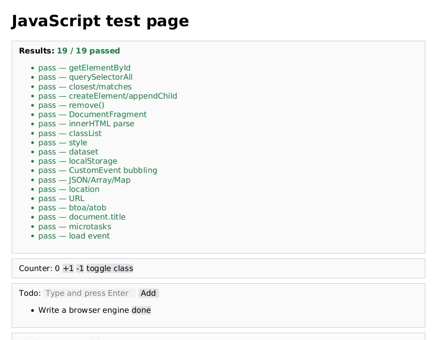
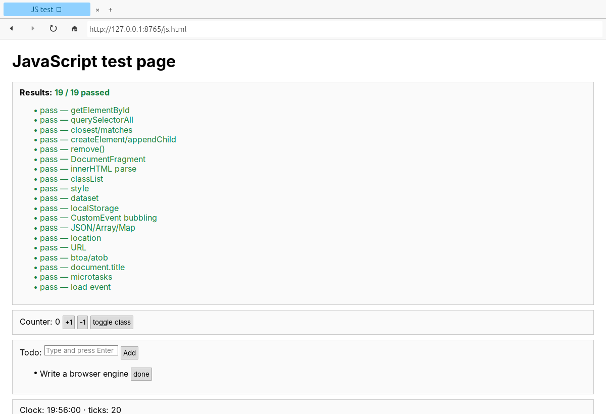
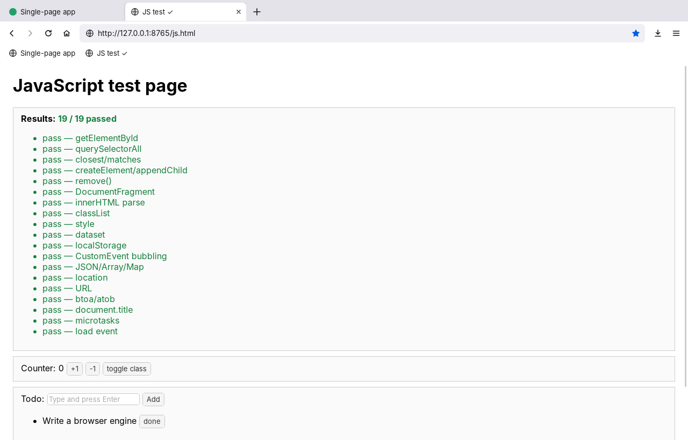

# rust-browsers

Three web browsers written in Rust, built to compare what it takes to write a browser engine yourself with what you get by embedding a production one.

| | [`rustbrowser`](rustbrowser) | [`servobrowser`](servobrowser) | [`webviewbrowser`](webviewbrowser) |
|---|---|---|---|
| Engine | Written from scratch in this repo | [Servo](https://servo.org) | The system's: Edge WebView2 (Chromium) on Windows, WebKitGTK on Linux |
| HTML and CSS | Own parser, cascade, block, inline and table layout | Servo's parser, Stylo (also used in Firefox), full CSS layout | Everything Chromium or WebKit supports |
| JavaScript | Boa, with DOM bindings written here | SpiderMonkey (Firefox's engine) | V8 on Windows, JavaScriptCore on Linux |
| Browser UI | Address bar and navigation | Tabs, address bar, dialogs | Firefox-style tabs, windows, private browsing, history, bookmarks, downloads, find, sessions, settings |
| Real-world sites | Simple and static pages | Many modern sites | Same as Edge or GNOME Web |
| First build | About 5 minutes | 25+ minutes, about 3 GB | A few minutes |
| Code | About 8,500 lines of Rust and 600 of JavaScript | About 1,200 lines of Rust | About 3,900 lines of Rust and 1,800 of HTML, CSS and JavaScript |

`rustbrowser` and `servobrowser` have an address bar that accepts URLs, local paths or search terms, back and forward history, reload, zoom, and a headless `--screenshot` mode for rendering a page to a PNG. `webviewbrowser` is the one to use day to day; see [its README](webviewbrowser/README.md) for the full feature list.

All three pass the same JavaScript test page ([`rustbrowser/test-pages/js.html`](rustbrowser/test-pages/js.html)):

| rustbrowser | servobrowser |
|---|---|
|  |  |



## Quick start

Install Rust from [rustup.rs](https://rustup.rs), then:

```
cd rustbrowser
cargo run --release
```

```
cd servobrowser
cargo run --release
```

```
cd webviewbrowser
cargo run --release
```

The Servo and webview browsers need system libraries first on Linux; see the [servobrowser](servobrowser/README.md#build) and [webviewbrowser](webviewbrowser/README.md#build-and-run) READMEs. On Windows, install the Visual Studio C++ build tools before running any of them.

## Repository layout

```
rustbrowser/    from-scratch engine and browser
  src/          parser, style, layout, paint, JavaScript runtime, window
  test-pages/   HTML pages for checking rendering and JavaScript by eye
servobrowser/   desktop shell around Servo
  src/          window, tabs, input routing, dialogs, browser: pages
webviewbrowser/ full browser on the system webview
  src/          windows, tabs, storage, settings, message handling
  ui/           toolbar, injected page script, browser: pages
docs/           screenshots
.github/        CI: formatting, build and unit tests
```

## Development

Each crate is independent, with its own `Cargo.lock`. Run `cargo fmt` before committing. CI checks formatting for all three crates, runs `cargo test` for `rustbrowser`, and runs clippy and the tests for `webviewbrowser` on both Linux and Windows. CI does not build `servobrowser` because Servo takes too long to compile there, so build it locally after changing it.

## License

MIT, see [LICENSE](LICENSE). Servo is MPL-2.0, Boa is MIT/Unlicense, and wry and tao are MIT/Apache-2.0; all are used as unmodified dependencies.
